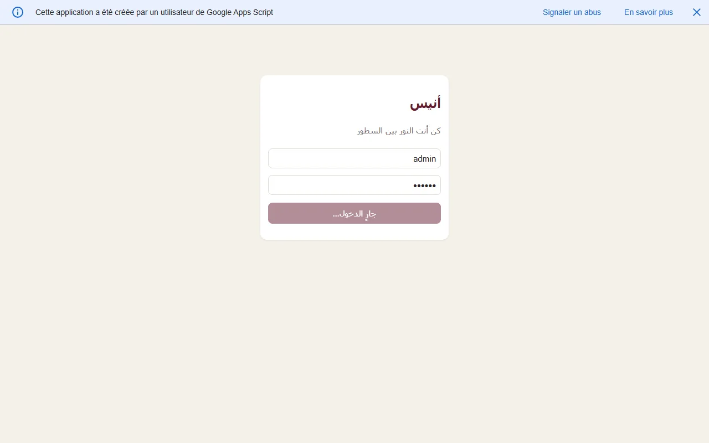
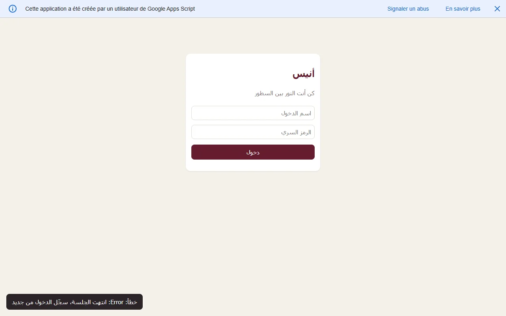
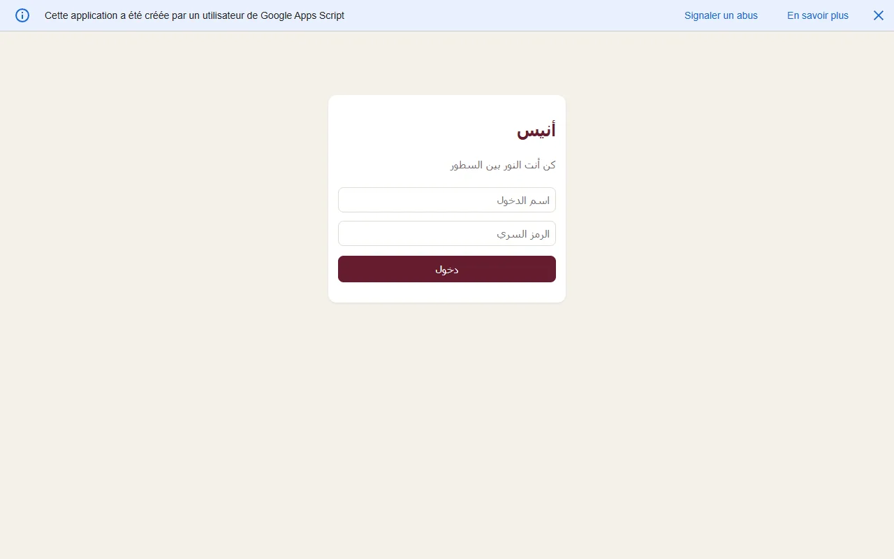
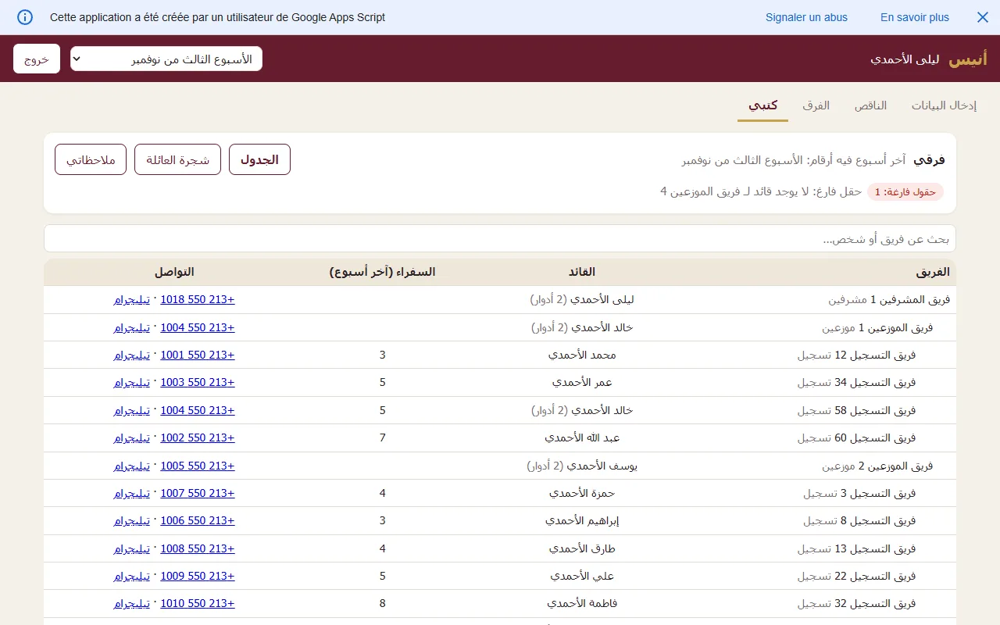
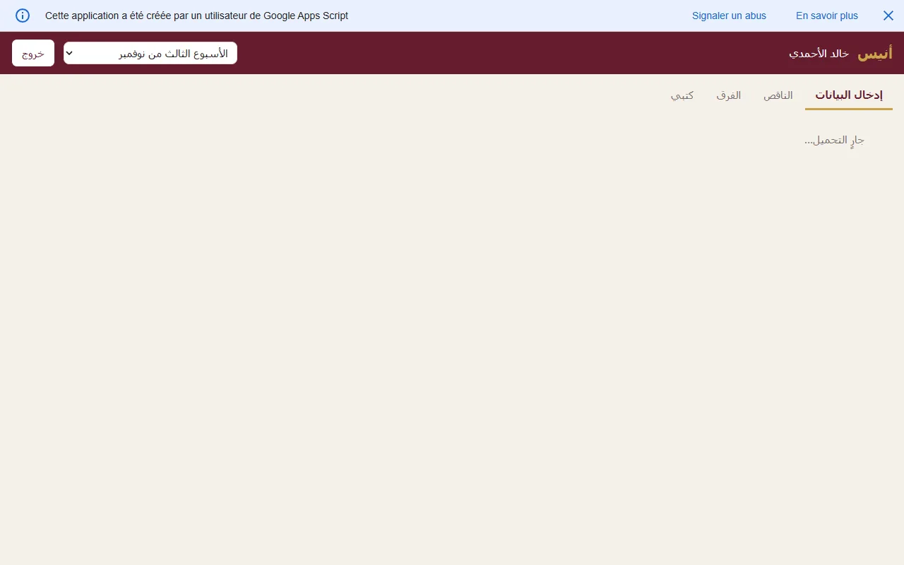
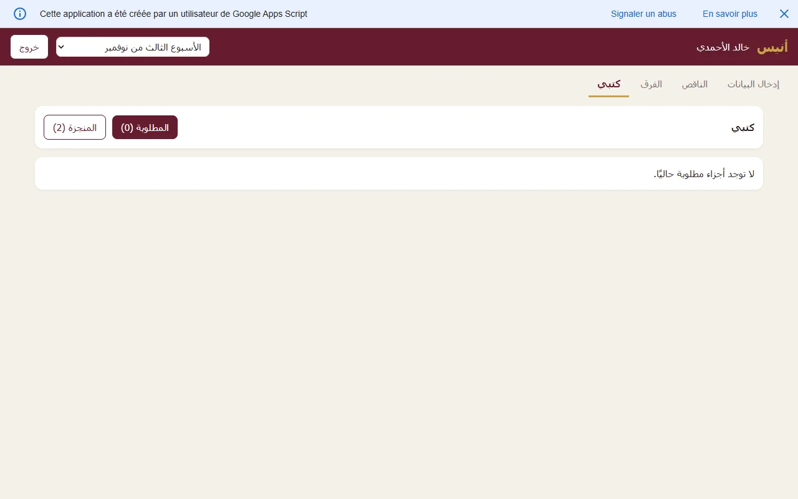

# دليل استخدام تطبيق «أنيس» (Anees User Guide)

> **«كن أنت النور بين السطور»**  
> دليل المستخدم الشامل والمفصل لتطبيق إدارة مهام القراءة وتوزيع الكتب ومتابعة الإنجاز الأسبوعي.

---

## الفهرس العام
1. [البداية: ما هو تطبيق أنيس؟](#1-البداية-ما-هو-تطبيق-أنيس)
2. [الهيكل الهرمي لأسرة أنيس ومسرد المصطلحات](#2-الهيكل-الهرمي-لأسرة-أنيس-ومسرد-المصطلحات)
3. [دليل مسؤول النظام (الأدمن - مسؤول الرابطين)](#3-دليل-مسؤول-النظام-الأدمن---مسؤول-الرابطين)
4. [دليل مسؤول الكتب](#4-دليل-مسؤول-الكتب)
5. [دليل الرابط (قائد فريق المشرفين)](#5-دليل-الرابط-قائد-فريق-المشرفين)
6. [دليل المشرف (قائد فريق الموزعين)](#6-دليل-المشرف-قائد-فريق-الموزعين)
7. [دليل قائد فريق الموزعين (تبويب كتبي)](#7-دليل-قائد-فريق-الموزعين-تبويب-كتبي)
8. [الأسئلة الشائعة (FAQ - 15 سؤالاً وجواباً)](#8-الأسئلة-الشائعة-faq)
9. [استكشاف الأخطاء الشائعة وحلولها (Troubleshooting)](#9-استكشاف-الأخطاء-الشائعة-وحولها)

---

## 1. البداية: ما هو تطبيق أنيس؟

تطبيق **«أنيس»** هو نظام ويب متكامل مبني على منصة Google Apps Script ومقترن بقاعدة بيانات سحابية منظمة في جداول Google Sheets. صُمم التطبيق لضبط ومتابعة إنجاز القراءة الأسبوعية لآلاف السفراء والقادة، وأتمتة قص وتوزيع أجزاء الكتب بصيغة PDF، وتوفير إحصائيات فورية دقيقة تعكس مؤشرات التزام كل فريق وفرع.

> **ملاحظة حول خطة الإطلاق التدريجي (Rollout):**  
> يعمل تطبيق أنيس خلال المرحلة الحالية جنباً إلى جنب مع الجداول القديمة المعتمدة، وسيكون في مرحلة لاحقة المنصة الحصرية المعتمدة لإدخال ومتابعة كافة البيانات.

---

## 2. الهيكل الهرمي لأسرة أنيس ومسرد المصطلحات

### الهرم الإداري والتنظيمي:
تتوزع أسرة أنيس وفق تسلسل هرمي محكم ومتماسك:
1. **مسؤول الرابطين (Head of Links):** وهو الأدمن (`ADMIN`) في التطبيق، ويدير الرابطين والهيكل العام والأسابيع والكتب.
2. **الرابط (Link):** يقود **فريق المشرفين** (يضم نحو 3 مشرفين). يوجد 4 روابط رئيسيين.
3. **المشرف (Supervisor):** يقود **فريق الموزعين** (يضم مجموعة من قادة فرق التوزيع).
4. **الموزع (Distributor):** يقود **فريق التسجيل** (يضم سفراء القراءة).
> **قاعدة ذهبية:** كل رابط وكل مشرف وكل موزع هو في الأصل سفير قراءة في أنيس.

### الفرق الخاصة والمصطلحات:
- **الأفرقة الفضية (Silver Teams):** فرق نوعية خاصة تخضع لإشراف ومتابعة الأدمن مباشرة.
- **غِراس أنيس (Ghiras):** مسار وفريق تدريبي خاص يتابعه الأدمن في التطبيق.
- **الرابط المسؤول على الكتاب:** حقل نصي حر في بطاقة الكتاب يُسجل فيه اسم المنسق المسؤول عن الروابط، ولا يشترط أن يكون لديه حساب دخول للنظام.
- **حسابات الدخول:** التطبيق يضم مستوى صلاحية وحيداً هو الأدمن (`ADMIN`)، إلى جانب حسابات الروابط والمشرفين ومسؤولي الكتب. **الموزعون العاديون ليس لديهم حسابات دخول حالياً**.

---

## 3. دليل مسؤول النظام (الأدمن - مسؤول الرابطين)

يمتلك الأدمن الصلاحية الكاملة على كافة شاشات وأدوات التطبيق:

### الخطوة 1: تسجيل الدخول
1. افتح رابط تطبيق أنيس في المتصفح.
2. اكتب اسم الدخول في خانة «اسم الدخول» (`#lg`).
3. أدخل الرمز السري في خانة «الرمز السري» (`#pn`).
4. اضغط زر «دخول» (`#go`).
> [!NOTE]
> لا تشارك رمزك السري مع أحد. الحسابات محمية بنظام تشفير قوي (Salted PBKDF2/SHA-256).

*الشكل 1: صفحة تسجيل الدخول للتطبيق (سطح المكتب والجوال).*

---

### الخطوة 2: استعراض الترويسة وشريط التبويبات واختيار الأسبوع
1. لاحظ اسمك في الترويسة العلوية بجوار شعار «أنيس».
2. استخدم القائمة المنسدلة (`#wk`) لاختيار الأسبوع المراد استعراضه أو إدارته (الأسبوع المغلق يحمل علامة `(مغلق)`).
3. تنقل بين التبويبات المتاحة: «إدخال البيانات»، «الناقص»، «الأسابيع»، «اللوحة»، «الفرق»، «الكتب»، «كتبي».

*الشكل 2: الترويسة الرئيسية وقائمة الأسابيع وتبويبات الأدمن.*

---

### الخطوة 3: إدارة إدخال البيانات ومراقبة الجداول
1. ادخل إلى تبويب «إدخال البيانات».
2. بدّل بين «جدول الموزعين» و «جدول المشرفين» عبر القائمة المنسدلة العلوية.
3. راقب «الخانات الحمراء ناقصة» التي تشير إلى مهام أو أرقام لم تُسجل بعد.
4. اكتب الأرقام في الخانات المطلوبة، ولاحظ تفعيل زر «حفظ (N)» وتحديث ألوان الصفوف المعدلة.
5. اضغط زر «حفظ» لتثبيت البيانات فورياً في قاعدة البيانات.

*الشكل 3: جدول إدخال بيانات الموزعين مع الخلايا الناقصة باللون الأحمر والمجاميع التلقائية.*

*الشكل 4: جدول إدخال بيانات المشرفين.*

---

### الخطوة 4: متابعة قائمة الناقص وتوليد رسائل التذكير
1. افتح تبويب «الناقص».
2. استعرض الفرق التي لديها بيانات غير مكتملة في الأسبوع النشط.
3. استخدم «بطاقة التذكير» لنسخ نص التذكير الجاهز وإرساله لقائد الفريق عبر تيليجرام.

*الشكل 5: قائمة النواقص وبطاقة صياغة رسائل المتابعة لتيليجرام.*

---

### الخطوة 5: إدارة دورة الأسابيع (الفتح، الإغلاق، الإجازة، والمزامنة)
1. انتقل إلى تبويب «الأسابيع».
2. للاطلاع على حالة الأسابيع: تجد الأسابيع مصنفة إلى مفتوحة، مغلقة، أو إجازة.
3. لتعطيل نشاط أسبوع وجعله عطلة استثنائية: اضغط خيار «إجازة» أمام الأسبوع.
4. لإغلاق أسبوع مكتمل: اضغط زر «إغلاق الأسبوع» (يشترط اكتمال كافة البيانات وخلوها من النواقص).
5. لإعادة فتح أسبوع استثنائياً: اضغط «إعادة فتح».
6. استخدم بطاقة المزامنة للإنعاش أو المزامنة المجدولة مع السجلات التاريخية.

*الشكل 6: بطاقات إدارة الأسابيع وأزرار الإغلاق والإجازة والمزامنة.*

---

### الخطوة 6: لوحة المؤشرات والإحصائيات وسد النقص
1. افتح تبويب «اللوحة».
2. استعرض التقرير الأسبوعي الشامل: عدد السفراء، نسبة الالتزام الإجمالية، النسبة المعدلة، والترتيب التنازلي للأفرقة.
3. اضغط «شهري» أو «سنوي» للاطلاع على الرسوم البيانية التراكمية ومعدلات النمو.
4. اضغط «سد النقص» لمعاينة حوض الصفحات المعوضة واحتساب ما تم تحويله إلى فائض.

*الشكل 7: اللوحة الإحصائية الأسبوعية ونسب الإنجاز وترتيب الفرق.*

*الشكل 8: شاشة إدارة واحتساب سد النقص.*

---

### الخطوة 7: إدارة شجرة الفرق والصلاحيات والعرض ثلاثي الأبعاد
1. افتح تبويب «الفرق».
2. استعرض شجرة العائلة ثنائية الأبعاد (2D) مع خيارات «توسيع الكل» و «طي الكل» و «نسخ كنص».
3. لتعيين أو تغيير قائد فريق: اضغط الزر الخاص بالقائد، وابحث عن اسم العضو، ثم أكد الاختيار.
4. لنقل فريق: اضغط «نقل»، وحدد المشرف أو الرابط الجديد ليتم تعديل الهيكل تلقائياً.
5. لإضافة فريق أو عضو جديد: انتقل للتبويب الفرعي المناسب واملأ البيانات بدقة.
6. لمشاهدة الهيكل الحي المتطور: اضغط «عرض ثلاثي الأبعاد» لفتح غابة أنيس الحية (3D Forest) في لسان مستقل، أو اضغط «نسخ رابط العرض» لمشاركة الرابط، أو «عرض تقني» للمجسم الكروي السابق.
7. راقب «جدول الصلاحيات» للتحكم فيمن «يعدّل فريقه»، واطلع على «سجل التغييرات» لمراجعة العمليات الرقابية.

*الشكل 9: شجرة الهيكل التنظيمي وأزرار التحكم بالعرض ثلاثي الأبعاد.*

*الشكل 10: واجهة غابة أنيس الحية التفاعلية ثلاثية الأبعاد.*

---

## 4. دليل مسؤول الكتب

يملك مستخدمو صلاحية الكتب (والأدمن) أدوات دورة حياة الكتاب من الرفع والقص وحتى التوزيع والحذف التلقائي:

### الخطوة 1: إضافة كتاب جديد
1. ادخل إلى تبويب «الكتب».
2. اضغط زر «+ كتاب جديد».
3. أدخل: عنوان الكتاب، عدد الصفحات الإجمالي، نطاق الصفحات (من - إلى)، اسم «الرابط المسؤول» (كنص حر)، ونوع الترقيم والمهمة.
4. ارفع ملف الكتاب بصيغة PDF (أو الصق رابطه في Google Drive).
5. اضغط حفظ.

*الشكل 11: نموذج إضافة كتاب ورفع ملف الـ PDF.*

---

### الخطوة 2: تقسيم الكتاب إلى أجزاء
1. في بطاقة الكتاب، اضغط زر «تقسيم».
2. يبدأ النظام تلقائياً عبر مشغل خلفي بقص الـ PDF إلى أجزاء متساوية (10 صفحات لكل جزء افتراضياً).
3. اضغط «عرض الأجزاء» لاستعراض الروابط المستقلة لكل جزء مع زر «نسخ الأجزاء».
> [!IMPORTANT]
> في حال كان الكتاب موزعاً مسبقاً وأردت تغيير النطاق أو إعادة تقسيمه، ستظهر لك رسالة تأكيد: «تقسيم جديد» تفيد بأن التقسيم الجديد سينشأ في مجلد جديد باسم المجلد القديم مع النطاق واسمك ولا يُحذف القديم. اضغط تأكيد للمتابعة.

*الشكل 12: قائمة أجزاء الكتاب وروابط ملفات الـ PDF وزر النسخ.*

---

### الخطوة 3: توزيع أجزاء الكتاب على الفرق
1. اضغط زر «توزيع الأجزاء».
2. يعرض النظام جدول التوزيع الآلي وفق عدد سفراء كل فريق من فرق الموزعين النشطة (تأتي الأفرقة الفضية 101 وغراس 102 في نهاية الترتيب).
3. راجع التخصيص ثم اضغط زر «اعتماد التوزيع».

*الشكل 13: شاشة توزيع أجزاء الكتاب على فرق الموزعين.*

---

## 5. دليل الرابط (قائد فريق المشرفين)

الرابط هو همزة الوصل بين مسؤول الرابطين والمشرفين:
1. **تسجيل الدخول:** باستخدام اسم الحساب المسند لك والرمز السري.
2. **إدخال البيانات:** في تبويب «إدخال البيانات»، يرى الرابط الفرق التابعة لفرعه الإشرافي فقط، ويدخل مؤشرات الإنجاز ويسلم التقرير.
3. **متابعة الفرع:** في تبويب «الفرق»، يقتصر عرض الشجرة على المشرفين والموزعين التابعين لفرعه.
4. **تبويب «كتبي» والتأشير بالنيابة:**
   - يرى الرابط كافة الأجزاء الموزعة على جميع فرق فرعه.
   - إذا تعذر على قائد فريق الموزعين التأشير، يمكن للرابط الضغط على زر «تم» نيابة عن الفريق.
   - يسجل النظام هذه العملية فورياً في سجل الرقابة (Audit Log) بعبارة: `on behalf of [Team Name]`.

*الشكل 14: تبويب «كتبي» لدى الرابط وخيار التأشير «تم» نيابة عن فرق الفرع.*

---

## 6. دليل المشرف (قائد فريق الموزعين)

المشرف مسؤول عن توجيه ومتابعة قادة فرق التوزيع:
1. **إدخال البيانات الأسبوعية:** يدخل المشرف إلى تبويب «إدخال البيانات» لتعبئة إنجازات فرق الموزعين التابعة له والتأكد من عدم وجود خانات حمراء.
2. **متابعة النواقص:** يدخل إلى تبويب «الناقص» لمشاهدة تقارير التقصير المباشرة واستخراج رسائل التذكير.
3. **إرسال الملاحظات:** عبر تبويب «ملاحظاتي»، يستطيع المشرف الإبلاغ عن أي حالة استثنائية (مغادرة سفير، مشكلة تقنية) لتصل إلى صندوق ملاحظات الأدمن لمراجعتها.

*الشكل 15: واجهة إدخال البيانات المخصصة للمشرف.*

---

## 7. دليل قائد فريق الموزعين (تبويب كتبي)

يظهر تبويب **«كتبي»** لكل قائد فريق توزيع مسندة إليه أجزاء كتب للقراءة:

### خطوات العمل:
1. افتح تبويب **«كتبي»** (`#myparts`).
2. لاحظ بطاقات الأجزاء المخصصة لفريقك: اسم الكتاب، رقم الجزء، ونطاق الصفحات (مثال: من 1 إلى 10)، ورابط تحميل الجزء.
3. بعد استكمال سفراء الفريق قراءة الجزء المخصص: اضغط زر **«تم»**.
4. فور الضغط على «تم»، تتحول الحالة وتُسجل لحظة الإنجاز باسمك، ويظهر **تاريخ الحذف التلقائي للملف** بعد 21 يوماً.

> [!CAUTION]
> **قاعدة الحذف التلقائي النهائي (21 يوماً):**  
> يقوم مشغل آلي يومي عند الساعة 05:00 فجراً بحذف ملف الجزء بصورة نهائية من Google Drive وتفريغ روابطه بعد مرور 21 يوماً من إنجاز **جميع** الأفرقة المسند إليها هذا الجزء. احرص على حفظ أي نسخة ضرورية قبل حلول هذا التاريخ.

*الشكل 16: تبويب «كتبي» لقائد فريق الموزعين ومؤشر تاريخ الحذف التلقائي.*

---

## 8. الأسئلة الشائعة (FAQ)

### س1: ما هو دور تطبيق أنيس الأساسي؟
**ج:** إدارة المنظومة الإدارية لأسبوع القراءة، تسجيل الإنجازات الأسبوعية، توزيع أجزاء الكتب المقصوصة رقمياً، واحتساب نسب التزام السفراء والأفرقة آلياً وبدقة.

### س2: ما هو التسلسل الهرمي المعتمد في أسرة أنيس؟
**ج:** مسؤول الرابطين (الأدمن) ← 4 روابط (كل رابط يقود فريق مشرفين) ← المشرفون (كل مشرف يقود فريق موزعين) ← الموزعون (كل موزع يقود فريق تسجيل يضم السفراء).

### س3: هل يملك الموزعون العاديون حسابات دخول للتطبيق؟
**ج:** لا؛ في الوقت الحالي لا يملك الموزعون العاديون حسابات دخول، والوصول متاح لقادة فرق الموزعين والمشرفين والروابط ومسؤولي النظام فقط.

### س4: هل يوجد دور "إدارة" (Management) منفصل في التطبيق؟
**ج:** لا؛ التطبيق يحتوي على مستوى صلاحية وحيد عالي المستوى هو الأدمن (`ADMIN`)، ولا يوجد دور باسم "إدارة" في النظام البرمجي.

### س5: ماذا تعني الخانات الحمراء في جدول إدخال البيانات؟
**ج:** تعني أن هناك بيانات مفقودة أو مهام لم تُحدد حالتها بعد، ويجب استكمالها لتصبح الخلية طبيعية ويتاح إغلاق الأسبوع.

### س6: كيف يتم حفظ البيانات أثناء الإدخال؟
**ج:** عند تعديل أي خانة يظهر عدد التعديلات على زر الحفظ: «حفظ (N)»، وبالضغط عليه تُرسل التعديلات وتُثبت فورياً دون إعادة تحميل الصفحة.

### س7: متى يمكن إغلاق الأسبوع؟
**ج:** لا يمكن إغلاق الأسبوع إلا بعد استكمال 100% من بيانات الفرق وخلو الجداول من أي خانات حمراء، ويقوم الأدمن بإغلاقه لترحيل الإحصائيات.

### س8: ما هو أسبوع "الإجازة"؟
**ج:** خيار يتيحه الأدمن لتعطيل الأسبوع في المناسبات والأعياد دون التأثير على تسلسل ونسب الالتزام السنوية للأفرقة.

### س9: كيف يتم تعويض النقص في القراءة؟
**ج:** يتم رصد الصفحات المقصر فيها في حوض النقص، وعند إنجاز صفحات تعويضية تُسجل في خانة "سد النقص"، ويقوم النظام بنقل الفائض الزائد عن النقص آلياً لحساب الصفحات الإضافية.

### س10: ما هي الأفرقة الفضية وفريق غراس؟
**ج:** الأفرقة الفضية (`Silver Teams`) هي فرق ذات طبيعة خاصة، وفريق غراس مسار تدريبي نوعي، ويشرف عليهما الأدمن مباشرة في توزيع الكتب والمتابعة.

### س11: كيف يتم تقسيم الكتب بصيغة PDF؟
**ج:** يعتمد التطبيق محركاً برمجياً داخلياً خالصاً (`pdf-lib`) يقص الكتاب إلى أجزاء (10 صفحات لكل جزء) في غضون ثوانٍ ودون إرسال الملفات لأي خادم خارجي.

### س12: ماذا يعني زر «تقسيم جديد» في بطاقة الكتاب؟
**ج:** يظهر عند تعديل نطاق صفحات كتاب تم توزيعه في السابق، وينبه المستخدم إلى أن التقسيم الجديد سيُحفظ في مجلد مستقل دون حذف التقسيم السابق حفاظاً على سجلات الفرق.

### س13: ما هي صلاحية الرابط في تبويب «كتبي»؟
**ج:** يرى الرابط جميع أجزاء فرق فرعه الإشرافي، ويملك صلاحية التأشير «تم» نيابة عن أي فريق مع قيد ذلك تلقائياً في سجل الرقابة (`Audit Log`).

### س14: متى يتم حذف ملفات أجزاء الكتب من Google Drive نهائياً؟
**ج:** تُحذف ملفات الأجزاء تلقائياً ونهائياً بعد انقضاء 21 يوماً من تاريخ تأشير كافة الأفرقة المسند إليها هذا الجزء كمنجز («تم»)، عبر مشغل يومي يعمل عند الساعة 05:00 فجراً.

### س15: كيف أصل إلى عرض غابة أنيس ثلاثية الأبعاد (3D Forest)؟
**ج:** من تبويب «الفرق»، يضغط الأدمن على زر «عرض ثلاثي الأبعاد» ليفتح العرض في نافذة مستقلة، أو يضغط «نسخ رابط العرض» لمشاركة الرابط التفاعلي المباشر.

---

## 9. استكشاف الأخطاء الشائعة وحلولها (Troubleshooting)

### 1. الرمز السري مغلق أو منسي (Locked PIN):
- **السبب:** محاولات دخول خاطئة متكررة أو نسيان الرمز.
- **الحل:** تواصل مع مسؤول الرابطين (الأدمن)؛ حيث يملك الأدمن من خلال جدول المستخدمين توليد رمز مؤقت أو إعادة تعيين الرمز السري لحسابك فورياً.

### 2. الأسبوع مغلق ولا يمكن التعديل عليه (Closed Week):
- **السبب:** تم إغلاق الأسبوع من قبل الإدارة بعد اكتمال المدة المحددة.
- **الحل:** الجداول تصبح للقراءة فقط؛ وإذا وُجد تعديل اضطراري يمكن للأدمن وحده استخدام زر «إعادة فتح» للأسبوع ثم إعادة إغلاقه بعد التصحيح.

### 3. زر الحفظ معطل ولا يقبل الحفظ (Can't Save):
- **السبب:** لا توجد تعديلات جديدة، أو أن المدخلات تحتوي قيماً غير مقبولة (مثل نصوص في حقول الأرقام)، أو انقطاع الاتصال بالإنترنت.
- **الحل:** تأكد من إدخال أرقام صحيحة، وتحقق من اتصالك، وستلاحظ تفعيل الزر وظهور عدد الحقول المعدلة: «حفظ (N)».

### 4. تعذر تقسيم الكتاب أو بقاء الأجزاء بحالة معلقة (Can't Split / Pending):
- **السبب:** التقسيم الآلي يعمل عبر مشغل زمني خلفي (`processSplits`) يبدأ بعد نحو 60 ثانية من الضغط على زر التقسيم لحماية استقرار الجلسة.
- **الحل:** انتظر من دقيقة إلى دقيقتين ثم قم بتحديث الصفحة؛ وستتحول حالة الأجزاء تلقائياً من `PENDING` إلى `DONE` وتظهر روابط التحميل الفردية.
